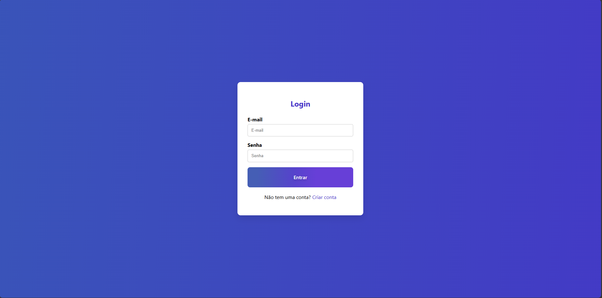
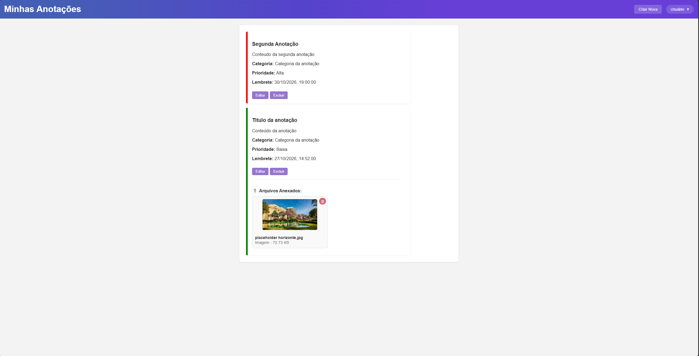
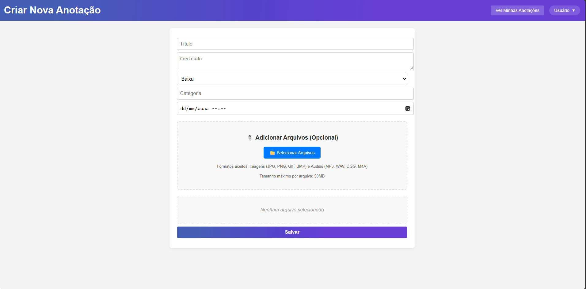
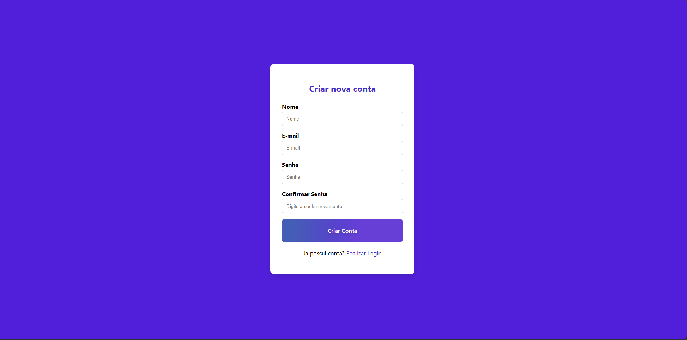
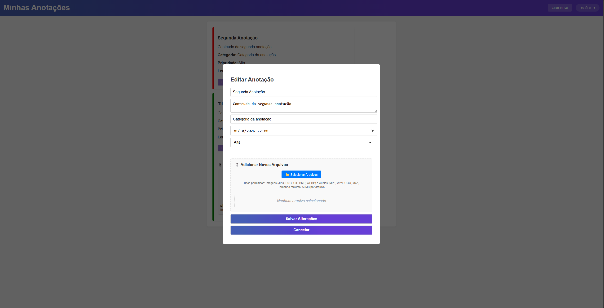

# MultimediaNotes

Sistema web para criação e gerenciamento de **anotações multimídia**. Além de texto, cada anotação pode ter **imagens e áudios anexados**, além de categoria, prioridade e data de lembrete. Cada usuário acessa apenas sua conta, protegida por autenticação JWT.

O projeto é dividido em uma **API REST em ASP.NET Core** e um **frontend web em HTML, CSS e JavaScript puro**, orquestrados com Docker Compose junto de um banco MySQL.

---

## Sobre este projeto

O objetivo foi construir uma aplicação completa de ponta a ponta, do banco de dados à interface, exercitando:

- API REST em camadas (Controllers → Services → Repositories) com injeção de dependência
- Autenticação e cadastro com **ASP.NET Core Identity** + **JWT**
- Mapeamento entre entidades e DTOs com **AutoMapper**
- Upload, armazenamento e streaming de arquivos (imagens e áudios) com validação de tipo e tamanho
- Modelagem relacional com **Entity Framework Core** (Usuário → Anotações → Arquivos de mídia, com exclusão em cascata)
- Frontend em JavaScript modular (ES Modules) consumindo a API com `fetch`, tratamento de sessão expirada e logout automático
- Containerização do backend, do frontend (Nginx) e do banco com **Docker Compose**

---


## Screenshots

Adicione aqui as capturas de tela do projeto. Sugestão de telas:

### Login e criação de conta


### Lista de anotações


### Criação de anotação com anexos


### Criação de usuário


### Edição de anotação


---


## Funcionalidades

- Cadastro e login de usuários com **JWT** (expiração configurável)
- Criação, listagem, edição e exclusão de anotações com título, conteúdo, categoria, prioridade e lembrete
- **Prioridade** em três níveis (Baixa, Média, Alta), com destaque por cor na listagem (verde, laranja e vermelho) e ordenação da mais alta para a mais baixa
- **Anexos de mídia** em cada anotação:
  - Imagens: `JPG`, `JPEG`, `PNG`, `GIF`, `BMP`
  - Áudios: `MP3`, `WAV`, `OGG`, `M4A`
  - Até **50 MB** por arquivo
- Pré-visualização dos arquivos antes do envio, com opção de remover; imagens exibidas em miniatura e áudios com player embutido
- Edição de anotação com possibilidade de adicionar novos arquivos (inclusive arrastando e soltando) e excluir os já anexados
- Arquivos protegidos: só são servidos para requisições autenticadas
- Sessão expirada ou token inválido leva ao logout automático e redireciona para o login
- Layout responsivo, adaptado a telas largas e estreitas
- Documentação interativa da API com **Swagger**

---

## Tecnologias

**Backend**
- C# / .NET 9 (ASP.NET Core Web API)
- Entity Framework Core
- MySQL 8
- ASP.NET Core Identity
- Autenticação JWT Bearer
- AutoMapper
- Swagger (OpenAPI)
- Docker

**Frontend**
- HTML5, CSS3 e JavaScript (ES Modules), sem frameworks
- `fetch` API para consumo da REST API
- `localStorage` para armazenamento do token JWT
- Docker + Nginx (servidor da versão em container)

---

## Estrutura do projeto

```
.
├── docker-compose.yml
├── MultimediaNotes.sln
├── MultimediaNotes.API/            # Backend (ASP.NET Core)
│   ├── Context/                    # AppDbContext (EF Core + Identity)
│   ├── Controllers/                # Auth, User, Annotation, MediaFile
│   ├── DTOs/                       # DTOs e MappingProfile (AutoMapper)
│   ├── Models/                     # Entidades e Repositories
│   ├── Services/                   # Regras de negócio e JWT
│   ├── appsettings.json
│   ├── Program.cs
│   └── Dockerfile
└── MultimediaNotes.FrontEnd/       # Frontend (HTML/CSS/JS)
    ├── CSS/                        # style.css, login.css
    ├── JS/                         # auth.js, api.js, mediaFileApi.js, notes.js, create.js, login.js, create_user.js
    ├── login.html
    ├── create_user.html
    ├── notes.html
    ├── create.html
    ├── default.conf                # Configuração do Nginx
    └── Dockerfile
```

---

## Pré-requisitos

- [Docker](https://www.docker.com/) e Docker Compose — necessário para o jeito recomendado de rodar o projeto
- Para rodar **sem Docker** (desenvolvimento local):
  - [.NET 9 SDK](https://dotnet.microsoft.com/download)
  - MySQL 8 (pode ser o container do próprio `docker-compose`)
  - Ferramenta do EF Core: `dotnet tool install --global dotnet-ef`

---

## ⚠️ Configuração antes de rodar

### 1. Credenciais do banco e chave JWT

Os valores sensíveis ficam em dois lugares: no `appsettings.json` da API e no `docker-compose.yml`. **Troque os valores de exemplo pelos seus** e nunca versione senhas ou chaves reais.

**`MultimediaNotes.API/appsettings.json`**

```json
{
  "ConnectionStrings": {
    "DefaultConnection": "Server=localhost;Database=MultimediaNotes;Uid=root;Pwd=SUA_SENHA_DO_MYSQL"
  },
  "JwtSettings": {
    "SecretKey": "CRIE_UMA_CHAVE_LONGA_E_ALEATORIA_AQUI",
    "Issuer": "MultimediaNotes.API",
    "Audience": "MultimediaNotes.Client",
    "ExpirationHours": 24
  }
}
```

| Chave | Descrição |
|---|---|
| `ConnectionStrings:DefaultConnection` | String de conexão com o MySQL |
| `JwtSettings:SecretKey` | Chave usada para assinar os tokens JWT (use **32 caracteres ou mais**, aleatórios) |
| `JwtSettings:Issuer` / `Audience` | Emissor e público do token |
| `JwtSettings:ExpirationHours` | Tempo de validade do token, em horas |

Para gerar uma chave aleatória:

```bash
# Linux / macOS / Git Bash
openssl rand -base64 48

# PowerShell
[System.Convert]::ToBase64String([System.Security.Cryptography.RandomNumberGenerator]::GetBytes(48))
```

> Qualquer configuração do `appsettings.json` pode ser sobrescrita por variáveis de ambiente usando `__` como separador, por exemplo `ConnectionStrings__DefaultConnection` e `JwtSettings__SecretKey`. É o que o `docker-compose.yml` faz com a string de conexão, apontando `Server=mysql` (nome do serviço do banco na rede Docker).

### 2. `docker-compose.yml`

A mesma senha do MySQL precisa aparecer em dois pontos do arquivo, o serviço `backend` e o serviço `mysql`:

```yaml
backend:
  environment:
    - ConnectionStrings__DefaultConnection=Server=mysql;Database=MultimediaNotes;Uid=root;Pwd=SUA_SENHA_DO_MYSQL

mysql:
  environment:
    MYSQL_ROOT_PASSWORD: SUA_SENHA_DO_MYSQL
    MYSQL_DATABASE: MultimediaNotes
```

> Dica: para não deixar a senha escrita no arquivo, crie um `.env` na raiz (já ignorado pelo `.dockerignore`) e referencie com `${MYSQL_ROOT_PASSWORD}` no `docker-compose.yml`.

### 3. Criação das tabelas (migrations)

A API não aplica migrations sozinha ao iniciar. Com o MySQL no ar, crie as tabelas uma vez a partir da pasta da API:

```bash
cd MultimediaNotes.API
dotnet ef database update
```

> Rodando a partir da sua máquina, a conexão usa o `Server=localhost` do `appsettings.json`. O container do MySQL já expõe a porta `3306` para isso.

---

## Como rodar

### Opção 01 — Docker (recomendado)

Sobe o banco, a API e o frontend com um único comando:

```bash
docker-compose up -d --build
```

Depois de subir os containers (e criar as tabelas, conforme a seção anterior), acesse:

| Serviço | URL |
|---|---|
| **Frontend** | http://127.0.0.1:3000 |
| **API + Swagger** | http://localhost:5145 |
| **MySQL** | `localhost:3306` |

> ⚠️ Acesse o frontend por **`127.0.0.1`**, e não por `localhost`. A política de CORS da API libera somente a origem `http://127.0.0.1:3000`, então abrir por `localhost:3000` faz as requisições serem bloqueadas pelo navegador.

> Os arquivos enviados ficam na pasta `uploads/` dentro do container da API. Para não perdê-los ao recriar o container, monte um volume para esse diretório no `docker-compose.yml`.

### Opção 02 — Desenvolvimento local (sem Docker no backend e no frontend)

**1. Suba apenas o banco:**

```bash
docker-compose up -d mysql
```

**2. Aplique as migrations e rode a API:**

```bash
cd MultimediaNotes.API
dotnet ef database update
dotnet run --launch-profile http
```

A API sobe em `http://localhost:5145`, com o Swagger na raiz.

**3. Sirva o frontend na porta 3000** (qualquer servidor estático serve, desde que seja a partir da raiz da pasta e em `127.0.0.1`):

```bash
cd MultimediaNotes.FrontEnd
python -m http.server 3000 --bind 127.0.0.1
```

Acesse http://127.0.0.1:3000/login.html.

> A URL da API (`http://localhost:5145`) está escrita diretamente nos arquivos `auth.js`, `api.js`, `mediaFileApi.js`, `create.js` e `notes.js`. Se mudar a porta ou o host do backend, atualize esses arquivos.

---

## Solução de problemas

### Erro `ports are not available: exposing port TCP 0.0.0.0:3306`

```
Error response from daemon: ports are not available: exposing port TCP 0.0.0.0:3306 ...
bind: Only one usage of each socket address (protocol/network address/port) is normally permitted.
```

**Causa:** já existe um MySQL rodando na sua máquina (por exemplo, instalado como serviço do Windows) usando a porta `3306`, e o container do banco tenta usar a mesma porta. Os containers da API e do frontend chegam a ser criados, mas o banco não sobe e a aplicação não funciona.

Para confirmar quem está usando a porta (no Windows):

```bash
netstat -ano | findstr :3306
```

Há duas formas de resolver:

**Opção A — Parar o MySQL local.** Em um terminal como administrador (o nome do serviço pode variar, confira em `services.msc`):

```bash
net stop MySQL80
docker-compose up -d
```

**Opção B — Mudar a porta do banco no Docker.** No `docker-compose.yml`, troque o mapeamento do serviço `mysql` para uma porta livre do seu computador, por exemplo `3307`:

```yaml
mysql:
  ports:
    - "3307:3306"
```

A API não é afetada, pois dentro da rede do Docker ela continua acessando o banco em `mysql:3306`. A mudança só vale para quem acessa o banco **de fora** do Docker, como o `dotnet ef database update` rodado na sua máquina. Nesse caso, informe a porta na string de conexão do `appsettings.json`:

```
Server=localhost;Port=3307;Database=MultimediaNotes;Uid=root;Pwd=SUA_SENHA_DO_MYSQL
```

Depois de resolver, suba novamente com `docker-compose up -d`.

> O mesmo tipo de conflito pode ocorrer com as portas `3000` (frontend) e `5145` (API) se outro programa as estiver usando. A solução é a mesma: liberar a porta ou alterar o mapeamento `porta_da_sua_máquina:porta_do_container` no `docker-compose.yml`. Se mudar a porta da API, atualize também a URL nos arquivos `.js` do frontend, e se mudar a do frontend, ajuste a origem permitida no CORS do `Program.cs`.

### "Erro interno do servidor" ao criar conta ou fazer login

Se a API responde `400` com a mensagem `Erro interno do servidor` ao cadastrar um usuário, ela provavelmente não está conseguindo acessar o banco. Verifique:

1. **O MySQL está rodando?** Rode `docker-compose ps` e confira se o serviço `mysql` está `running` (ou `healthy`).
2. **As tabelas foram criadas?** Se o banco está vazio, aplique as migrations:

```bash
cd MultimediaNotes.API
dotnet ef database update
```

Para ver o erro real, consulte os logs da API:

```bash
docker-compose logs backend
```

> As migrations só precisam ser aplicadas uma vez. Os dados ficam guardados no volume `mysql_data` e permanecem entre reinicializações. Só será necessário aplicá-las de novo se o volume for apagado (`docker-compose down -v`).

---

## Primeiro acesso

Não existe usuário padrão. Na tela de login, clique em **Criar conta** e cadastre-se com nome, e-mail e senha. A senha deve ter:

- no mínimo 6 caracteres
- pelo menos uma letra maiúscula, uma minúscula e um número

Após 5 tentativas de login incorretas, a conta fica bloqueada por 5 minutos.

---

## Endpoints da API

Todas as rotas, exceto `login` e `register`, exigem o header `Authorization: Bearer <token>`.

### Auth — `/api/Auth`

| Método | Rota | Descrição |
|---|---|---|
| POST | `/login` | Autentica e retorna o token JWT |
| POST | `/register` | Cria uma conta e retorna o token JWT |
| GET | `/validate` | Verifica se o token atual é válido |

### Annotation — `/api/Annotation`

| Método | Rota | Descrição |
|---|---|---|
| GET | `/` | Lista todas as anotações |
| GET | `/{id}` | Busca uma anotação pelo id |
| GET | `/user/{userId}` | Lista as anotações de um usuário |
| POST | `/` | Cria uma anotação |
| PUT | `/` | Atualiza uma anotação (o `id` vai no corpo) |
| DELETE | `/{id}` | Exclui uma anotação e seus arquivos |

### MediaFile — `/api/MediaFile`

| Método | Rota | Descrição |
|---|---|---|
| GET | `/annotation/{annotationId}` | Lista os arquivos de uma anotação |
| GET | `/{id}` | Baixa/transmite o arquivo |
| POST | `/upload` | Envia um arquivo (`multipart/form-data` com os campos `File` e `AnnotationId`) |
| DELETE | `/{id}` | Exclui o arquivo |

### User — `/api/User`

| Método | Rota | Descrição |
|---|---|---|
| GET | `/` | Lista os usuários |
| GET | `/annotations` | Lista os usuários com suas anotações |
| GET | `/{id}` | Busca um usuário pelo id |
| POST | `/` | Cria um usuário |
| PUT | `/{id}` | Atualiza um usuário |
| DELETE | `/{id}` | Exclui um usuário |

---

## Modelo de dados

```
User (1) ────< Annotation (1) ────< MediaFile
```

| Entidade | Campos principais |
|---|---|
| **User** | `Id`, `Name`, `Email` + campos do ASP.NET Identity |
| **Annotation** | `Id`, `Title` (até 50), `Content`, `Category` (até 50), `Priority` (1 a 3), `Reminder`, `UserId` |
| **MediaFile** | `Id`, `FileName`, `FilePath`, `FileType` (`image` ou `audio`), `MimeType`, `FileSize`, `CreatedAt`, `AnnotationId` |

Excluir um usuário remove suas anotações, e excluir uma anotação remove seus arquivos (exclusão em cascata).

---

## Limitações conhecidas e melhorias futuras

Este projeto foi desenvolvido com foco em aprendizado e **não está pronto para ser colocado em produção**. Alguns pontos de segurança e de arquitetura são conhecidos e ficaram como melhorias futuras:

**Segurança**

- **Credenciais versionadas:** o `appsettings.json` e o `docker-compose.yml` contêm a senha do MySQL e a chave JWT escritas diretamente, e permanecem no histórico do Git. Esses valores existem apenas para o ambiente de desenvolvimento deste projeto, e **devem ser trocados** (e movidos para variáveis de ambiente, `.env` ou `dotnet user-secrets`) em qualquer uso real.
- **Falta de controle de propriedade:** os endpoints de anotações e arquivos exigem login, mas não verificam se o recurso pertence ao usuário autenticado. Na prática, quem conhece o `id` de uma anotação ou arquivo consegue consultá-lo ou alterá-lo. O `userId` da anotação também é enviado pelo cliente, em vez de ser lido do token.
- **Gerenciamento de usuários sem restrição:** os endpoints de `/api/User` podem ser usados por qualquer usuário autenticado, não há perfis (como administrador). O `POST /api/User` cria o usuário com uma senha temporária fixa no código.
- **Token no `localStorage`:** o JWT é guardado no `localStorage`, que fica exposto caso exista alguma falha de XSS. Parte da interface é montada com `innerHTML`, e valores controlados pelo usuário (como nomes de arquivo) precisam ser escapados.
- **Validação de uploads:** os arquivos são validados pela extensão e pelo tamanho, e não pelo conteúdo real.
- **Configuração de execução:** o container da API roda com `ASPNETCORE_ENVIRONMENT=Development` (Swagger exposto) e sem HTTPS configurado.

**Arquitetura e qualidade**

- As migrations são aplicadas manualmente, e a URL da API está escrita direto nos arquivos JavaScript do frontend.
- Os arquivos enviados ficam no disco do container, sem volume persistente.
- Os erros do `AuthService` são capturados sem registro em log, o que dificulta o diagnóstico.
- Não há testes automatizados.

**Próximos passos planejados**

1. Remover credenciais do repositório (`appsettings.example.json` + variáveis de ambiente) e gerar uma nova chave JWT.
2. Ler o usuário a partir do token e validar a propriedade de anotações e arquivos em todos os endpoints.
3. Restringir o gerenciamento de usuários a um perfil administrador.
4. Adicionar logs, testes e um volume para os uploads.

---

<!--## Licença
Este projeto está sob a licença MIT — veja o arquivo [LICENSE](LICENSE) para mais detalhes.
---
-->
## Autor

**Luís Henrique De Oliveira Ruppenthal**
[GitHub](https://github.com/LuisRuppenthal)